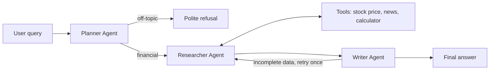

# AI-Powered Financial News Summarizer Agent

A multi-agent system that answers financial questions using live market data. Three specialized agents plan the task, collect data with tools, and write a verified summary. Built with LangChain and LangGraph, with a Streamlit chat interface.

## How It Works



| Agent | Role |
|---|---|
| **Planner** | Checks that the query is financial and splits it into 2-4 steps. Off-topic queries stop here. |
| **Researcher** | Runs a tool-calling loop, picks tools dynamically, and retries when a tool returns an error. |
| **Writer** | Writes the answer using only the collected data and checks it for completeness. |

## Features

- **Task decomposition:** a plan is created before any tool is called.
- **Dynamic tool selection:** the LLM chooses between `get_stock_price` (yfinance), `get_financial_news` (Google News RSS) and `calculator`.
- **Short-term memory:** a shared state plus the last 4 chat turns, so follow-up questions work.
- **Self-correction:** tool errors go back to the LLM to fix and retry; the Writer can request one extra research round.
- **Fallbacks:** step limit, caught tool crashes, and an honest "data not found" answer instead of guessing.
- **Transparency:** a live agent trace shows each step.

## Tech Stack

Python, LangChain, LangGraph, Groq (Llama 3.3 70B), yfinance, Google News RSS, Streamlit

## Project Structure

```
├── main.py            # Streamlit UI
├── terminal_chat.py   # Terminal chat (no Streamlit needed)
├── agents.py          # Planner, Researcher and Writer agents
├── graph.py           # LangGraph workflow and shared state
├── tools.py           # Stock price, news and calculator tools
├── config.py          # LLM and settings
├── test_cases.py      # Edge-case tests
├── requirements.txt
```

## Setup

Requires Python 3.10 or higher and a free [Groq API key](https://console.groq.com).

```bash
uv venv
.venv\Scripts\Activate.ps1        # Windows (macOS/Linux: source .venv/bin/activate)
uv pip install -r requirements.txt
copy .env.example .env            # macOS/Linux: cp .env.example .env
```

Open `.env` and set `GROQ_API_KEY`.

## Run

```bash
python -m streamlit run main.py   # web UI
python terminal_chat.py           # terminal mode
```

## Testing

```bash
python test_cases.py              # run all edge cases
python test_cases.py 5            # run one test by number
```

| Edge case | Expected behavior |
|---|---|
| Invalid ticker | Tool error, retry, then "not found" |
| Empty news result | Broader search, then says so |
| Off-topic or gibberish | Refused politely, no tools called |
| Empty input | Asks for a question |
| Follow-up question | Uses chat memory |
| Prediction or advice request | Facts only, no advice |
| Prompt injection | Ignored, stays on task |

## Limitations

- Prices are the latest daily close, not tick-by-tick real time.
- News is limited to the top 5 recent headlines.
- Memory covers only recent turns and resets when the session ends.
- The free Groq tier has rate limits.

*This project provides information only, not financial advice.*
